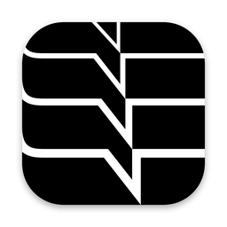
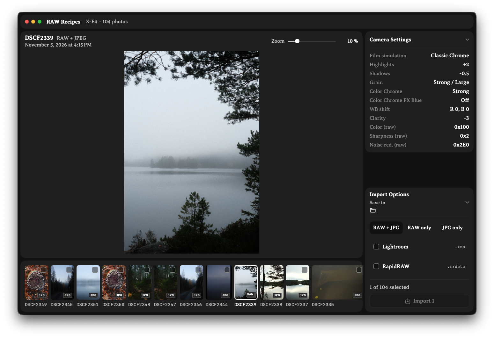

<p align="center">
  
</p>

<h1 align="center">RAW Recipes</h1>

<p align="center">
  Review photos straight from your Fujifilm camera, import them in one click,<br>
  and keep your in-camera recipe as the starting point for your RAW edits.
</p>

<p align="center">
  <a href="https://github.com/maslugit/RAW-Recipes/releases/latest"></a>
  <a href="LICENSE"></a>
  
</p>

<p align="center">
  
</p>

---

## Why RAW Recipes?

When you shoot RAW + JPEG, the camera applies your recipe – film simulation, highlight and shadow tone, grain, color chrome – to the JPEG. The RAW file only stores those settings as metadata, so most editors throw them away: the photo looks right in the preview, then snaps back to a flat rendering when you start editing.

RAW Recipes reads the recipe from every RAW file and writes it next to the photo as a sidecar file, so Lightroom and RapidRAW open your RAW files with your camera look as the starting point.

## Features

- **Review before import** – browse the photos on the camera over USB, with a large preview and zoom up to 400 %, before anything is copied.
- **Fast previews** – uses the JPEG preview embedded in each RAF file, so only a few hundred kB are read per photo. The full file is only downloaded when you zoom past what the preview can show.
- **Camera settings at a glance** – film simulation, dynamic range, highlights, shadows, grain, color chrome, white balance shift and clarity for every photo.
- **Lightroom sidecars (.xmp)** – the matching Camera Matching profile plus highlights, shadows, grain, clarity and monochrome.
- **RapidRAW sidecars (.rrdata)** – highlights, shadows, grain, clarity and monochrome with color filter.
- **RAW + JPG, RAW only or JPG only** – import exactly the files you want.
- **Safe imports** – files are verified after download, and existing sidecars are never overwritten, so your own edits are kept.

### What carries over

| Camera setting | Lightroom (.xmp) | RapidRAW (.rrdata) |
|---|---|---|
| Film simulation | Camera Matching profile | – (RapidRAW has no Fujifilm profiles) |
| Monochrome / Acros | Black & white | Monochrome + color filter |
| Highlight / shadow tone | Highlights / Shadows | Highlights / Shadows |
| Grain effect | Grain amount + size | Grain amount + size |
| Clarity | Clarity | Clarity |
| Color chrome, tone curves | – | – |

The mappings are a first approximation and will be tuned over time. Comparisons against the camera JPEG are very welcome – see [Contributing](#contributing).

## Getting started

### Download

Get the latest `.dmg` from the [Releases page](https://github.com/maslugit/RAW-Recipes/releases), open it and drag **RAW Recipes** to Applications.

### First launch

RAW Recipes is not notarized by Apple yet, so macOS blocks it the first time:

1. Open RAW Recipes. macOS says it cannot be opened.
2. Go to **System Settings → Privacy & Security**, scroll down and click **Open Anyway**.

Or run this once in Terminal:

```sh
xattr -dr com.apple.quarantine "/Applications/RAW Recipes.app"
```

### Camera setup

1. On the camera, set **CONNECTION SETTING → PC CONNECTION MODE → USB CARD READER**.
2. Stop Photos from opening automatically: open **Image Capture**, select the camera and set *Connecting this camera opens* to **No application**.
3. Quit Photos and Image Capture while RAW Recipes is running, so they do not lock the camera.
4. Connect the camera with a USB cable.

## Usage

- Click a photo in the filmstrip to preview it. Tick the checkbox to select it for import, or press **⌘A** to select all (**⌥⌘A** deselects).
- Zoom with the slider, the mouse wheel, a two-finger swipe up/down or a pinch on the trackpad. Drag to move around. Double-click the slider handle to fit the photo again.
- Under **Import Options**, choose RAW + JPG, RAW only or JPG only, the sidecars you want, and the destination folder.
- Click **Import** or press **⌘I**.

In Lightroom, the `.xmp` sidecar is read when the RAF is imported into the catalog for the first time. RapidRAW reads the `.rrdata` file when the photo is opened.

## Compatibility

Tested with the **Fujifilm X-E4**. Other X-series and GFX cameras that store RAF files with Fujifilm MakerNotes should work, but have not been verified yet – reports are welcome.

Requires macOS 13 Ventura or later, on Apple silicon or Intel.

## Roadmap

- In-camera RAW conversion over USB (like Fujifilm X RAW Studio), using the camera's own processor for an exact Fujifilm rendering.
- Calibrated mappings for every film simulation and setting.
- Verified support for more camera models.

## Building from source

Requires Xcode 15 or later.

```sh
git clone https://github.com/maslugit/RAW-Recipes.git
cd RAW-Recipes
./build-app.sh            # builds "build/RAW Recipes.app"
./build-app.sh --package  # also creates a .dmg and a .zip in dist/
```

To work on the code, open `Package.swift` in Xcode and run the **RAWRecipes** scheme (⌘R).

### Releasing

Push a version tag. GitHub Actions builds the app and creates a draft release with the `.dmg` and `.zip` attached:

```sh
git tag v0.1.0
git push origin v0.1.0
```

## Contributing

Bug reports, camera test reports and pull requests are welcome. For camera-settings issues, a sample RAF + JPG pair of the same shot is the most useful thing you can attach.

## Acknowledgements

- [RapidRAW](https://github.com/CyberTimon/RapidRAW) by CyberTimon – the RAW editor this app writes sidecars for.
- [ExifTool](https://exiftool.org) by Phil Harvey – documentation of the Fujifilm MakerNote tags.
- [fudge](https://github.com/petabyt/fudge) and [fp](https://github.com/petabyt/fp) by petabyt – research on Fujifilm's USB protocol.
- [Averia Serif Libre](https://fonts.google.com/specimen/Averia+Serif+Libre) by Dan Sayers – SIL Open Font License 1.1.

## Disclaimer

RAW Recipes is an independent project and is not affiliated with, endorsed by or sponsored by Fujifilm, Adobe or the RapidRAW project. Fujifilm, Lightroom and all film simulation names are trademarks of their respective owners.

## License

RAW Recipes is licensed under the [GNU Affero General Public License v3.0](LICENSE). The bundled Averia Serif Libre font is licensed under the [SIL Open Font License 1.1](Sources/RAWRecipes/Resources/Fonts/OFL.txt).
